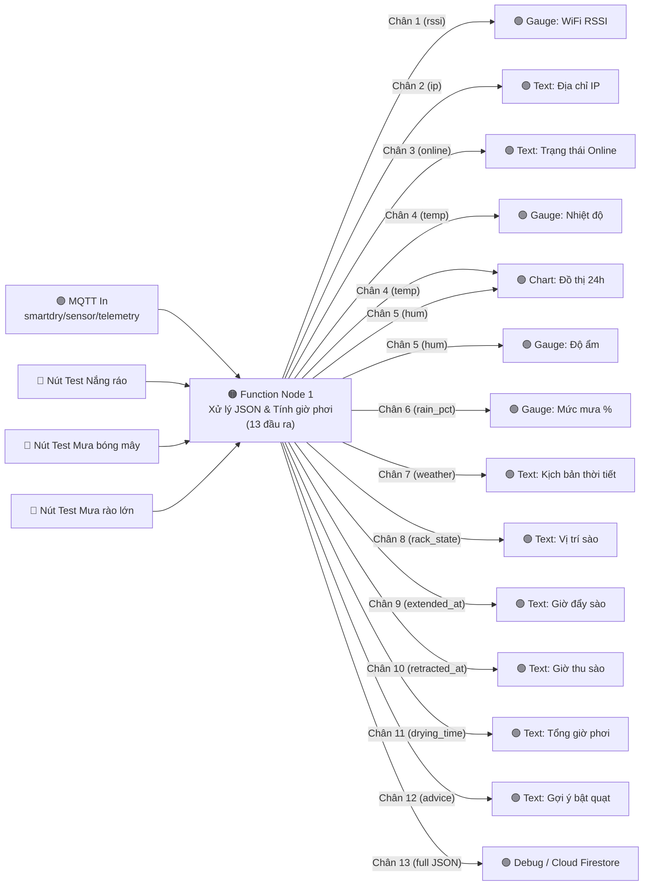
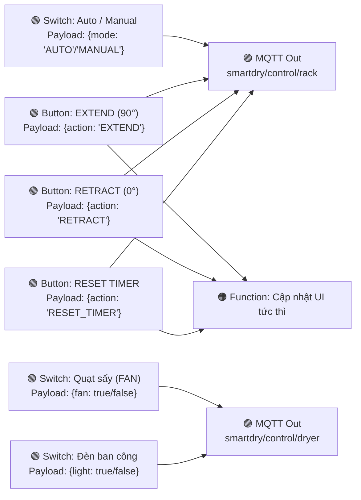
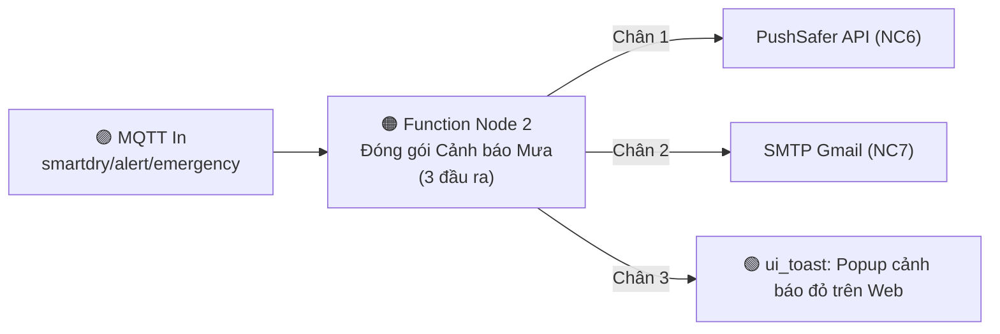
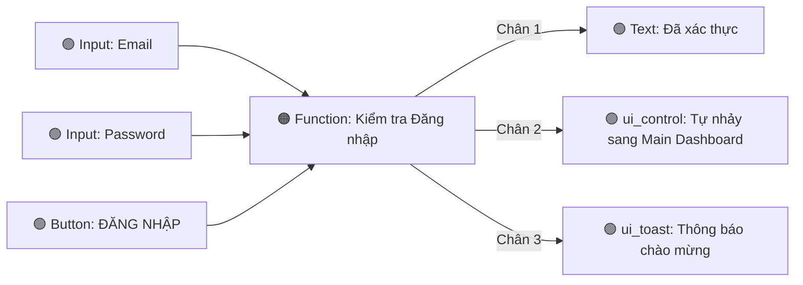

# HƯỚNG DẪN CHI TIẾT CÁCH NỐI CÁC KHỐI (NODES) & NÂNG CẤP GIAO DIỆN TRÊN NODE-RED
**Dự án:** AeroDry IoT (SmartBreeze Pro) – Hệ thống giàn phơi thông minh  
**File luồng chính:** `nodered_data/flows.json`

---

## 1. NGUYÊN TẮC CỐT LÕI KHI NỐI DÂY TRONG NODE-RED

Trong Node-RED, mọi dữ liệu chạy qua dây nối giữa các khối đều nằm trong một biến đối tượng duy nhất tên là **`msg`**, trong đó quan trọng nhất là:
* **`msg.payload`**: Chứa giá trị chính (ví dụ: số nhiệt độ `32.5`, chuỗi `"02:05:20"`, hoặc đối tượng JSON `{"action": "EXTEND"}`).
* **`msg.topic`**: Chứa nhãn phân loại (dùng để phân biệt đường biểu đồ `"Nhiệt độ (°C)"` hay `"Độ ẩm (%)"`, hoặc tên kênh MQTT).

---

## 2. SƠ ĐỒ GIẢI THÍCH CÁCH NỐI TỪNG CỤM TRONG `flows.json`

### Cụm 1: Luồng Nhận Dữ Liệu Cảm Biến & Bộ Đếm Thời Gian Phơi (Uplink)



#### Giải thích tại sao `Function Node 1` lại có 13 chân đầu ra (Outputs):
* Mạch ESP32 gửi lên **1 cục JSON gộp chung** tất cả thông số:
  ```json
  {
    "temp": 32.5, "hum": 62, "rain_pct": 5, "weather_type": "NANG_RAO",
    "drying_time_str": "02:05:20", "fan": false, "rssi": -56, "ip": "192.168.1.108", "rack_state": 1
  }
  ```
* Nhưng mỗi đồng hồ (`ui_gauge`) hoặc dòng chữ (`ui_text`) trên giao diện Web chỉ nhận **1 giá trị đơn lẻ** trong `msg.payload`.
* Vì vậy, `Function Node 1` dùng lệnh `return [ out1, out2, ..., out13 ]` để tách gói JSON thành **13 chân đầu ra riêng biệt** (bạn rê chuột vào từng chấm tròn bên phải khối `Function Node 1` sẽ thấy thứ tự từ trên xuống dưới từ 1 đến 13).
* **Đặc biệt ở Chân 4 (Nhiệt độ) và Chân 5 (Độ ẩm):** Mỗi chân được nối vào **2 nơi cùng lúc** (vừa nối vào đồng hồ `Gauge`, vừa nối chung vào `Biểu đồ Nhiệt độ & Độ ẩm 24h`). Nhờ có `topic: "Nhiệt độ (°C)"` và `topic: "Độ ẩm (%)"`, biểu đồ `ui_chart` tự động vẽ thành **2 đường màu khác nhau** trên cùng 1 đồ thị!

---

### Cụm 2: Luồng Điều Khiển Sào Servo, Quạt Sấy & Đèn (Downlink)



* **Cách hoạt động:**
  * Trong mỗi nút bấm (`ui_button`) hoặc công tắc (`ui_switch`), mình đã cấu hình sẵn ô **Payload** dưới dạng JSON khớp với hàm `mqttCallback()` trong code C++ của ESP32:
    * Nút **EXTEND**: gửi `{"action": "EXTEND"}` $\rightarrow$ nối vào `MQTT Out (smartdry/control/rack)`.
    * Nút **RETRACT**: gửi `{"action": "RETRACT"}` $\rightarrow$ nối vào `MQTT Out (smartdry/control/rack)`.
    * Nút **RESET TIMER**: gửi `{"action": "RESET_TIMER"}` $\rightarrow$ nối vào `MQTT Out (smartdry/control/rack)`.
    * Công tắc **QUẠT SẤY**: khi bật gửi `{"fan": true}`, khi tắt gửi `{"fan": false}` $\rightarrow$ nối vào `MQTT Out (smartdry/control/dryer)`.

---

### Cụm 3: Luồng Cảnh Báo Mưa Khẩn Cấp (Emergency Notification - NC6, NC7)



---

### Cụm 4: Luồng Màn Hình Đăng Nhập (Login View - NC9)



---

## 3. CÁCH NÂNG CẤP GIAO DIỆN (UI) TRONG NODE-RED ĐẸP HƠN

Mặc định `node-red-dashboard` dùng giao diện phẳng cổ điển. Để biến giao diện thành **Smart Home Dashboard hiện đại**, bạn có **3 kỹ thuật mạnh nhất**:

1. **Kỹ thuật 1 – Tiêm Custom CSS toàn cục bằng khối `ui_template` (`Added to site <head> section`):**
   * Chèn một khối `ui_template` chứa CSS giúp bo tròn các khung Cột 1, Cột 2, Cột 3 (`border-radius: 14px`), tạo bóng đổ nổi (`box-shadow`), đổi thanh tiêu đề sang màu **Gradient Xanh Dương – Ngọc Lục Bảo**, làm nổi bật nút bấm khi di chuột (`hover`).
2. **Kỹ thuật 2 – Thêm Widget HTML/SVG động (`ui_template` trong Group):**
   * Tạo **Đồng hồ LED Kỹ thuật số (Digital Timer Card)** cỡ lớn hiển thị thời gian đã phơi `02:05:20` và **Mô phỏng hình ảnh Sào phơi xoay góc 0° / 90° + Cánh quạt sấy quay tròn** ngay trên giao diện!
3. **Kỹ thuật 3 – Tinh chỉnh Layout & Theme trong bảng `Dashboard` bên phải Editor:**
   * Mở tab `Dashboard` $\rightarrow$ `Theme` để chỉnh font chữ, màu nền, hoặc `Site` $\rightarrow$ `Sizes` để tăng kích thước ô lưới.
