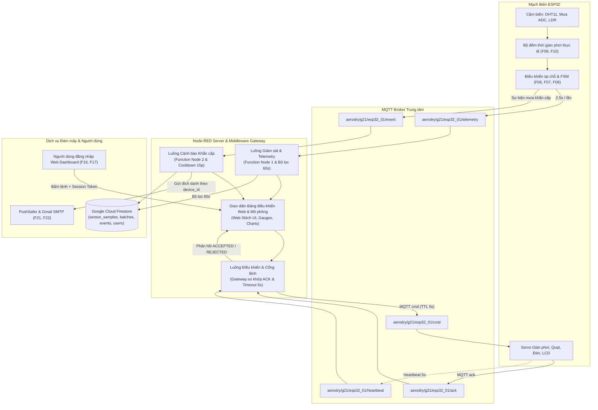
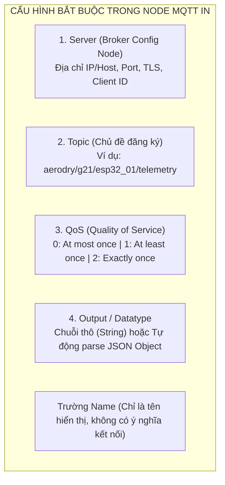
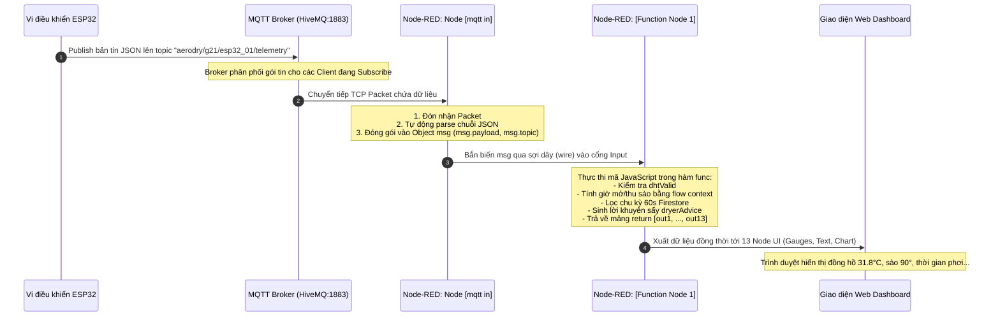

# CẨM NANG KỸ THUẬT: ĐẶC TẢ TOÀN BỘ CÁC CỤM CHỨC NĂNG TRÊN NODE-RED
## ĐỒ ÁN: AERODRY IoT (SMARTBREEZE PRO) – HỆ THỐNG GIÀN PHƠI THÔNG MINH
**Học phần:** Vật lý cho Công nghệ Thông tin (PHY00007) – Lớp 24C11 – Nhóm 21  
**Tài liệu chuẩn hóa đối chiếu 100% theo Đề xuất Đồ án Chính thức ([main (2).pdf](file:///D:/III_HK1/VL/Project/main%20(2).pdf))**

---

## 1. KIẾN TRÚC VÀ CÁC LUỒNG DỮ LIỆU CỐT LÕI (MỤC 4.1 TRONG PROPOSAL)

Theo Mục 4.1 (Trang 10) của bản Đề xuất đồ án, hệ thống AeroDry IoT được tổ chức thành 4 luồng dữ liệu chính:



* **Luồng 1 - Giám sát (Monitoring Flow):** Cảm biến và nút nhấn $\rightarrow$ ESP32 $\rightarrow$ MQTT broker $\rightarrow$ Node-RED $\rightarrow$ Dashboard và Firestore.
* **Luồng 2 - Điều khiển (Control Flow):** Người dùng đã đăng nhập $\rightarrow$ Dashboard $\rightarrow$ Node-RED Gateway $\rightarrow$ MQTT $\rightarrow$ ESP32 $\rightarrow$ Servo, relay quạt hoặc LED. ESP32 gửi lại bản tin ACK để cập nhật giao diện.
* **Luồng 3 - Cảnh báo (Alert Flow):** ESP32 phát hiện mưa $\rightarrow$ MQTT $\rightarrow$ Node-RED $\rightarrow$ PushSafer và Email SMTP gửi đích danh tới người dùng sở hữu thiết bị (`device_id`).
* **Luồng 4 - Mô phỏng (Simulation Flow - F23):** Giả lập dữ liệu thời tiết (Nắng ráo, Độ ẩm kéo dài, Mưa lớn) để kiểm thử giao diện mà không tác động mạch thật hay gửi mail rác.

---

## 2. BẢNG ĐỐI CHIẾU CHỨC NĂNG (F01–F24) & PHÂN CÔNG (W01–W24)

Dưới đây là bảng chuẩn hóa toàn bộ các chức năng theo đúng **Chương 2 (Mục F)** và **Chương 5.3 (Mục W)** trong Proposal:

| Mã CN | Tên Chức năng trong Đề xuất | Mã W | Phụ trách chính | Vị trí Mã nguồn cụ thể |
| :---: | :--- | :---: | :---: | :--- |
| **F01** | Đọc nhiệt độ và độ ẩm DHT11 | W02 | Phong | [esp32_aerodry/sensors.h](file:///D:/III_HK1/VL/Project/esp32_aerodry/sensors.h) |
| **F02** | Đọc trạng thái ướt (cảm biến mưa ADC) | W03 | Phong | [esp32_aerodry/sensors.h](file:///D:/III_HK1/VL/Project/esp32_aerodry/sensors.h) |
| **F03** | Đọc ánh sáng LDR (ngưỡng trễ sáng/tối) | W02 | Phong | [esp32_aerodry/sensors.h](file:///D:/III_HK1/VL/Project/esp32_aerodry/sensors.h) |
| **F04** | Thu và đưa sào ra (Servo 0° và 90°) | W12 | Linh | [esp32_aerodry/esp32_aerodry.ino](file:///D:/III_HK1/VL/Project/esp32_aerodry/esp32_aerodry.ino) |
| **F05** | Điều khiển bằng nút nhấn vật lý | W12 | Linh | [esp32_aerodry/local_io.h](file:///D:/III_HK1/VL/Project/esp32_aerodry/local_io.h) |
| **F06** | Chuyển chế độ Auto và Manual | W05 | Phong | [esp32_aerodry/state_machine.h](file:///D:/III_HK1/VL/Project/esp32_aerodry/state_machine.h) |
| **F07** | Thu sào tự động khi mưa / độ ẩm cao | W03, W05 | Phong | [esp32_aerodry/state_machine.h](file:///D:/III_HK1/VL/Project/esp32_aerodry/state_machine.h) |
| **F08** | Chờ khô trước khi mở lại (Xác nhận 180s) | W03 | Phong | [esp32_aerodry/state_machine.h](file:///D:/III_HK1/VL/Project/esp32_aerodry/state_machine.h) |
| **F09** | Ghi nhận thời gian phơi cộng dồn | W04 | Phong | [esp32_aerodry/drying_tracker.h](file:///D:/III_HK1/VL/Project/esp32_aerodry/drying_tracker.h) |
| **F10** | Đặt lại bộ đếm mẻ phơi mới (Reset) | W04 | Phong | [esp32_aerodry/drying_tracker.h](file:///D:/III_HK1/VL/Project/esp32_aerodry/drying_tracker.h) |
| **F11** | Hiển thị tại chỗ LCD1602 I2C | W13 | Linh | [esp32_aerodry/esp32_aerodry.ino](file:///D:/III_HK1/VL/Project/esp32_aerodry/esp32_aerodry.ino) |
| **F12** | Điều khiển quạt sấy đối lưu | W13 | Linh | [esp32_aerodry/local_io.h](file:///D:/III_HK1/VL/Project/esp32_aerodry/local_io.h) |
| **F13** | Điều khiển đèn chiếu sáng ban công | W13 | Linh | [esp32_aerodry/local_io.h](file:///D:/III_HK1/VL/Project/esp32_aerodry/local_io.h) |
| **F14** | Cấu hình Wi-Fi SoftAP / WiFiManager | W14 | Linh | [esp32_aerodry/esp32_aerodry.ino](file:///D:/III_HK1/VL/Project/esp32_aerodry/esp32_aerodry.ino) |
| **F15** | Theo dõi kết nối (Heartbeat, Online/Offline) | W14, W17 | Linh | [nodered_data/lib/control-gateway.js](file:///D:/III_HK1/VL/Project/nodered_data/lib/control-gateway.js) |
| **F16** | Đăng nhập và đăng xuất (Xác thực tài khoản) | W20 | Triết | [nodered_data/lib/control-gateway.js](file:///D:/III_HK1/VL/Project/nodered_data/lib/control-gateway.js), [UI_Stitch/Login Page](file:///D:/III_HK1/VL/Project/UI_Stitch/Login%20Page) |
| **F17** | Dashboard trực tuyến giám sát thời gian thực | W16 | Triết | [nodered_data/flows.json](file:///D:/III_HK1/VL/Project/nodered_data/flows.json), [UI_Stitch/GiaoDienChinh](file:///D:/III_HK1/VL/Project/UI_Stitch/GiaoDienChinh) |
| **F18** | Điều khiển từ website & Phản hồi thiết bị | W17 (UI) | Triết | [nodered_data/ui/control.js](file:///D:/III_HK1/VL/Project/nodered_data/ui/control.js) |
| **F19** | Lưu lịch sử cloud (Firestore chu kỳ 60s) | W18 | Triết (Chuyển giao Phong) | [backend_cloud_notify/src/firestoreService.js](file:///D:/III_HK1/VL/Project/backend_cloud_notify/src/firestoreService.js) |
| **F20** | Biểu đồ nhiệt ẩm 24h & Nhật ký phiên phơi | W19 | Triết (UI), Phong (Data) | [backend_cloud_notify/src/historyQueryService.js](file:///D:/III_HK1/VL/Project/backend_cloud_notify/src/historyQueryService.js), `ui_chart` |
| **F21** | Thông báo đẩy PushSafer về điện thoại | W21 | Triết (Chuyển giao Phong) | [backend_cloud_notify/src/notificationService.js](file:///D:/III_HK1/VL/Project/backend_cloud_notify/src/notificationService.js) |
| **F22** | Email cảnh báo mưa & độ ẩm cao qua SMTP | W21 | Triết (Chuyển giao Phong) | [backend_cloud_notify/src/notificationService.js](file:///D:/III_HK1/VL/Project/backend_cloud_notify/src/notificationService.js) |
| **F23** | Chế độ mô phỏng kịch bản thời tiết độc lập | W22 | Triết | [nodered_data/ui/control.js](file:///D:/III_HK1/VL/Project/nodered_data/ui/control.js), `ui_btn_sim_*` |
| **F24** | Xử lý gián đoạn mạng, mất điện & lỗi cảm biến | W04, W05 | Phong | [esp32_aerodry/mqtt_contract.h](file:///D:/III_HK1/VL/Project/esp32_aerodry/mqtt_contract.h), [state_machine.h](file:///D:/III_HK1/VL/Project/esp32_aerodry/state_machine.h) |

---

## 3. CHI TIẾT TỪNG CỤM FUNCTION TRÊN CANVAS NODE-RED

*Toàn bộ tên hiển thị trên giao diện Node-RED đã được tinh chỉnh thuần túy theo **chức năng kỹ thuật**, không để lộ mã công việc viết tắt hay tên cá nhân để đảm bảo tính chuyên nghiệp cao nhất:*

### Cụm 1: Luồng Thu thập Dữ liệu Cảm biến & Thời gian phơi (Uplink)
* **Node chính:** `Function Node 1: Xử lý Telemetry, Bộ lọc 60s Firestore & Lịch sử 24h` (`fn_process_telemetry`).
* **Nguyên lý hoạt động:**
  1. Hứng bản tin JSON định kỳ 2.5s từ node `MQTT In (telemetry)`.
  2. Kiểm tra cờ `dht_valid`: nếu cảm biến lỗi, gán `temp = null`, `hum = null`, phát nhãn cảnh báo `⚠️ LỖI CẢM BIẾN DHT11` và khóa tính năng tự động mở sào.
  3. Quản lý trạng thái chuyển động của sào phơi:
     * Khi sào chuyển sang $90^\circ$: ghi nhận mốc giờ bắt đầu mở phơi (`extend_timestamp`).
     * Khi sào chuyển về $0^\circ$: ghi nhận mốc giờ thu (`retract_timestamp`), tính thời lượng phiên phơi (`duration_sec`) và lưu vào mảng lịch sử 24h.
  4. **Bộ lọc 60 giây (F19):** Độc lập với chu kỳ 2.5s của Web, cứ mỗi 60 giây node mới xuất 1 bản ghi vào cổng số 13 nối sang node `Bản ghi lưu Cloud Firestore` để ghi vào database.
  5. **13 Cổng xuất dữ liệu:** Xuất trực tiếp dữ liệu số đến các đồng hồ đo (Nhiệt độ, Độ ẩm, Mức mưa, WiFi RSSI, Giờ mở/thu, Tổng giờ phơi thực tế).

---

### Cụm 2: Luồng Điều khiển Thiết bị & Cổng Lệnh (Downlink)
* **Node chính:** `Cổng điều khiển thiết bị: Xử lý lệnh, so khớp ACK & Heartbeat` (`fn_linh_control_gateway`).
* **Nguyên lý hoạt động:**
  1. **Nhận diện sống còn (F15):** Định kỳ 5s nhận heartbeat từ ESP32. Node `Kiểm tra timeout & trạng thái kết nối (1s)` quét liên tục: nếu quá 25s không có heartbeat hoặc mất kết nối Broker, Gateway chuyển sang `OFFLINE` và **khóa toàn bộ nút bấm điều khiển** trên Web.
  2. **Tạo lệnh và cấp `cmd_id` (F18):** Khi người dùng click nút trên web (Đẩy sào, Thu sào, Quạt, Đèn, Reset), Gateway tạo một mã ngẫu nhiên `cmd_id`, gắn thời hạn hiệu lực $TTL = 5\text{s}$, gửi xuống ESP32 qua node `Cổng gửi lệnh điều khiển MQTT (cmd)`.
  3. **So khớp ACK chống lệnh ma:** Khi nhận bản tin từ node `Nhận ACK phản hồi thiết bị`, Gateway đối chiếu đúng `cmd_id`, `boot_id` và `connection_id`. Nếu khớp, trả về trạng thái `ACCEPTED` lên giao diện; nếu quá 5s không có phản hồi, trả về `TIMEOUT`.

---

### Cụm 3: Luồng Cảnh báo Mưa Khẩn cấp qua PushSafer & Email SMTP
* **Node chính:** `Function Node 2: Xử lý Cảnh báo Mưa, PushSafer & Email SMTP` (`fn_emergency_alert`).
* **Nguyên lý hoạt động:**
  1. Lắng nghe sự kiện từ node `MQTT In (event)` khi ESP32 phát hiện mưa hoặc độ ẩm cao kéo dài (F21, F22).
  2. **Trích xuất `device_id`:** Lấy chính xác mã thiết bị gây ra cảnh báo (ví dụ `esp32_01`).
  3. **Thời gian chờ chống gửi trùng (Cooldown 15 phút):** Kích hoạt bộ đếm 15 phút. Nếu trong 15 phút này trời vẫn tiếp tục mưa, các sự kiện sau sẽ bị chặn lại để không gây nghẽn email người dùng.
  4. **Xuất 3 luồng cảnh báo đồng thời:**
     * Cổng 1 $\rightarrow$ `Bản tin gửi PushSafer API`: Gửi thông báo đẩy đến ứng dụng điện thoại.
     * Cổng 2 $\rightarrow$ `Nội dung Email cảnh báo SMTP`: Tạo email gửi đích danh người dùng sở hữu thiết bị kèm thông số môi trường và tổng giờ đã phơi.
     * Cổng 3 $\rightarrow$ `Popup Cảnh báo Mưa trên Web`: Bật thông báo khẩn màu đỏ ngay trên màn hình Dashboard.

---

### Cụm 4: Giao diện Bảng điều khiển Web Dashboard & Mô phỏng
* **Node chính:** `Giao diện Web Stitch Hiện đại (Sáng/Tối, Responsive)` (`ui_stitch_webapp`).
* **Nguyên lý hoạt động:**
  1. **Xác thực và phân quyền (F16):** Người dùng đăng nhập bằng Email/Password, quản lý phiên an toàn, tự động khóa điều khiển khi chưa đăng nhập.
  2. **Hiển thị trực quan (F17, F20):** Hiển thị các thông số thời gian thực, đồng hồ kim, biểu đồ nhiệt ẩm 24h và bảng nhật ký các phiên phơi.
  3. **Chế độ Mô phỏng (F23):** Cung cấp 3 kịch bản:
     * **☀️ Nắng ráo:** Nhiệt độ $33.5^\circ\text{C}$, Độ ẩm $58\%$, Mưa $0\%$, sào mở $90^\circ$.
     * **💧 Độ ẩm kéo dài:** Nhiệt độ $28.0^\circ\text{C}$, **Độ ẩm cao $88\%$**, Mưa $0\%$, sào mở nhưng hệ thống đưa ra khuyến nghị bật quạt đối lưu.
     * **⛈️ Mưa rào lớn:** Nhiệt độ $26.0^\circ\text{C}$, Độ ẩm $90\%$, **Mức mưa $82\%$**, lập tức thu sào $0^\circ$ và phát cảnh báo.
     * *Đặc tính an toàn:* Dữ liệu mô phỏng có cờ `is_simulation: true`, tuyệt đối không tác động servo thật và không gửi mail thật.


---

## 4. CHUYÊN ĐỀ SÂU: BẢN CHẤT CẤU HÌNH NODE MQTT IN, CƠ CHẾ TRUYỀN GÓI TIN VÀ LẬP TRÌNH FUNCTION NODE

### 4.1. Node "MQTT In" cấu hình ra sao? Có phải chỉ cần kéo ra rồi đặt tên là xong?

**Câu trả lời ngắn gọn:** **HOÀN TOÀN KHÔNG.**  
Trong Node-RED, trường **`Name`** (Tên) chỉ là một cái "nhãn dán" (label) hiển thị trên màn hình Canvas để lập trình viên dễ nhìn. Cho dù bạn đặt tên nó là "MQTT In", "Trạm nhận dữ liệu" hay để trống, thì về mặt kỹ thuật node đó **chưa hề hoạt động** nếu bạn chưa cấu hình 4 thông số kỹ thuật sống còn sau:



#### Chi tiết 4 thông số kỹ thuật bên trong Node MQTT In:

1. **Server (MQTT Broker Configuration Node):**
   * Đây không phải là một chuỗi văn bản thông thường, mà là một **Config Node độc lập** chạy ngầm trong Node-RED.
   * Để node `mqtt in` hoạt động, nó phải trỏ tới Broker cấu hình này (trong dự án đặt tên là `AeroDry broker`).
   * Các giá trị thực tế bên trong:
     * **Broker Host:** `${AERODRY_MQTT_HOST}` (mặc định trỏ về `broker.hivemq.com`).
     * **Port:** `${AERODRY_MQTT_PORT}` (mặc định là cổng `1883`).
     * **Client ID:** Để trống để Node-RED tự sinh chuỗi ngẫu nhiên tránh bị đá văng kết nối.
     * **Keep Alive:** `15` giây (gửi gói tin ping định kỳ để Broker biết Node-RED vẫn còn sống).
   * *Hiện tượng nếu cấu hình sai:* Node sẽ hiện chấm đỏ bên dưới kèm chữ `disconnected` hoặc `connecting...` và không thể nhận bất kỳ bản tin nào.

2. **Topic (Chủ đề muốn lắng nghe / Subscribe):**
   * Đây là địa chỉ đường ống dữ liệu trên Broker. ESP32 bắn tin lên Topic nào thì Node `mqtt in` phải điền chính xác Topic đó (phân biệt hoa thường, đúng từng dấu gạch chéo `/`).
   * Ví dụ trong dự án: `aerodry/g21/esp32_01/telemetry`.
   * *Mẹo nâng cao:* Node-RED hỗ trợ ký tự đại diện (Wildcard):
     * Ký tự `+`: Đại diện cho 1 cấp (ví dụ `aerodry/g21/+/telemetry` sẽ hứng dữ liệu của mọi trạm ESP32 nhóm 21).
     * Ký tự `#`: Đại diện cho toàn bộ các cấp con phía sau.

3. **QoS (Quality of Service):**
   * `0 - At most once`: Gửi nhanh nhất, không chờ xác nhận, có thể rơi gói tin nếu mạng chập chờn (ESP32 telemetry 2.5s dùng QoS 0 là tối ưu).
   * `1 - At least once`: Đảm bảo gói tin đến đích ít nhất 1 lần (có thể nhận trùng lặp).
   * `2 - Exactly once`: Đảm bảo gói tin đến đích chính xác 1 lần duy nhất (tốn băng thông nhất).

4. **Output / Datatype (Kiểu dữ liệu đầu ra xuất sang Function Node):**
   * Node-RED cung cấp 4 lựa chọn:
     * **`a parsed JSON object` (ĐƯỢC CHỌN TRONG DỰ ÁN NÀY):** Node-RED sẽ tự động nhận chuỗi byte/text từ MQTT, chạy `JSON.parse()` ngầm để chuyển thành một JavaScript Object hoàn chỉnh trước khi bắn sang Function Node.
     * `a UTF-8 string`: Giữ nguyên dạng chuỗi văn bản thô.
     * `a Buffer`: Giữ nguyên mảng byte nhị phân.
     * `auto-detect`: Tự động phán đoán (không khuyên dùng trong hệ thống công nghiệp).

---

### 4.2. Khai báo biến nào để nhận MQTT? Node MQTT gửi gì qua cho Function Node?

#### Câu trả lời: BẠN HOÀN TOÀN KHÔNG CẦN KHAI BÁO BIẾN TRƯỚC!
Trong các ngôn ngữ truyền thống như C/C++ hay Java, bạn phải khai báo:
```cpp
// C/C++: Phải khai báo biến trước
int temp;
char topic[50];
```
Nhưng trong **Node-RED (Event-Driven / Flow-based Programming)**:
* Khi Broker đẩy một gói tin về Node `mqtt in`, Node này tự động đóng gói toàn bộ thông tin của sự kiện đó vào một **JavaScript Object duy nhất** có tên quy ước quốc tế là:
$$\mathbf{msg} \quad (\text{Message Object})$$
* Node `mqtt in` sau đó đẩy object `msg` này chạy dọc theo sợi dây (`wire`) màu xám sang chân vào (Input port) của **Function Node**.
* Khi vào trong Function Node, biến `msg` **đã tồn tại sẵn** trong không gian bộ nhớ. Bạn chỉ việc mở ra xài trực tiếp mà không cần `let msg`, `var msg` hay `import` bất cứ thư viện nào!

#### Giải phẫu cấu trúc thực tế của biến `msg` mà MQTT gửi sang:

Khi ESP32 gửi gói tin Telemetry, biến `msg` đi vào Function Node 1 sẽ có cấu trúc chính xác như sau:

```javascript
msg = {
    // 1. Mã định danh duy nhất của gói tin trong nội bộ Node-RED (chuỗi hex ngẫu nhiên)
    "_msgid": "8c3b1e94a02f7d11",

    // 2. Tên Topic mà gói tin vừa đến
    "topic": "aerodry/g21/esp32_01/telemetry",

    // 3. Toàn bộ ruột dữ liệu do ESP32 gửi lên (Chính là msg.payload!)
    "payload": {
        "device_id": "esp32_01",
        "temp": 31.8,
        "hum": 62.4,
        "rain_pct": 0,
        "weather_type": "NANG_RAO",
        "rack_state": 1,
        "drying_sec": 4200,
        "drying_min": 70,
        "drying_time_str": "01:10:00",
        "fan": false,
        "light": false,
        "rssi": -55,
        "ip": "192.168.1.108",
        "dht_valid": true,
        "is_simulation": false
    },

    // 4. Mức độ đảm bảo truyền thông của MQTT
    "qos": 0,

    // 5. Cờ đánh dấu tin nhắn có được Broker lưu lại (Retain) hay không
    "retain": false
};
```

#### Cách Function Node đọc từng biến nhỏ xíu từ `msg`:
* Muốn đọc nhiệt độ: `msg.payload.temp` $\rightarrow$ ra số `31.8`.
* Muốn đọc độ ẩm: `msg.payload.hum` $\rightarrow$ ra số `62.4`.
* Muốn đọc vị trí sào: `msg.payload.rack_state` $\rightarrow$ ra số `1` (đang mở ngoài trời).
* Muốn đọc topic: `msg.topic` $\rightarrow$ ra `"aerodry/g21/esp32_01/telemetry"`.

---

### 4.3. Code có phải "chỉ nằm trong Function Node thôi là được" không?

**Hiểu đúng bản chất của Node-RED:**
Node-RED được thiết kế theo triết lý **Low-Code / No-Code (Lập trình cấu hình trực quan)**:

1. **Các Node chuyên dụng có sẵn (Không cần gõ 1 dòng code JS nào):**
   * **Node `switch`:** Chia nhánh luồng dựa trên điều kiện (ví dụ: Nếu `payload.temp > 35` thì đi dây trên, ngược lại đi dây dưới). Hoàn toàn chọn bằng chuột qua giao diện Dropdown.
   * **Node `change`:** Dùng để gán hoặc xóa biến (ví dụ: gán `msg.payload = 100`).
   * **Node `delay`:** Hãm tốc độ hoặc làm chậm gói tin.
   * **Node `ui_gauge`, `ui_text`:** Chỉ cần nối dây vào, nó tự động đọc `msg.payload` để hiển thị kim đồng hồ hoặc chữ lên Web.

2. **Vậy tại sao trong dự án AeroDry chúng ta lại viết code trong `Function Node`?**
   Function Node cho phép nhúng trực tiếp một **đoạn mã JavaScript chạy trên nền Node.js**. Chúng ta sử dụng Function Node vì logic của giàn phơi thông minh đòi hỏi những bài toán thuật toán mà các node đồ họa kéo thả thông thường **không thể giải quyết gọn gàng được**:
   
   * **Lưu nhớ trạng thái theo thời gian (`Stateful Memory`):** Các node thông thường không có bộ nhớ (Stateless), gói tin chạy qua là biến mất. Function Node có các hàm `flow.get()` và `flow.set()` cho phép nhớ trạng thái sào ở chu kỳ trước, nhớ mốc giờ mở sào, nhớ bộ đếm thời gian phơi cộng dồn.
   * **Bắt cạnh sự kiện chuyển trạng thái (Edge Detection):** Phát hiện đúng thời điểm sào vừa chuyển từ 0 sang 1 để chốt `extend_timestamp`, hoặc từ 1 về 0 để đóng phiên phơi và tính thời lượng.
   * **Bộ lọc chu kỳ 60s độc lập (F19):** Xử lý toán học so sánh `nowMs - lastSavedMs >= 60000` để chỉ đẩy mẫu lên Firebase đúng chu kỳ 1 phút/lần, trong khi Web vẫn nhận 2.5s/lần.
   * **Phân phối đồng thời ra 13 chân xuất (Multiple Outputs):** Hàm `return [out1, out2, ..., out13]` cho phép một Function Node tính toán 1 lần duy nhất rồi bắn kết quả trực tiếp đến 13 thiết bị/đồng hồ đo khác nhau một cách đồng bộ.

---

### 4.4. Sơ đồ tuần hoàn: Từ sóng Radio WiFi ESP32 đến Màn hình Web


