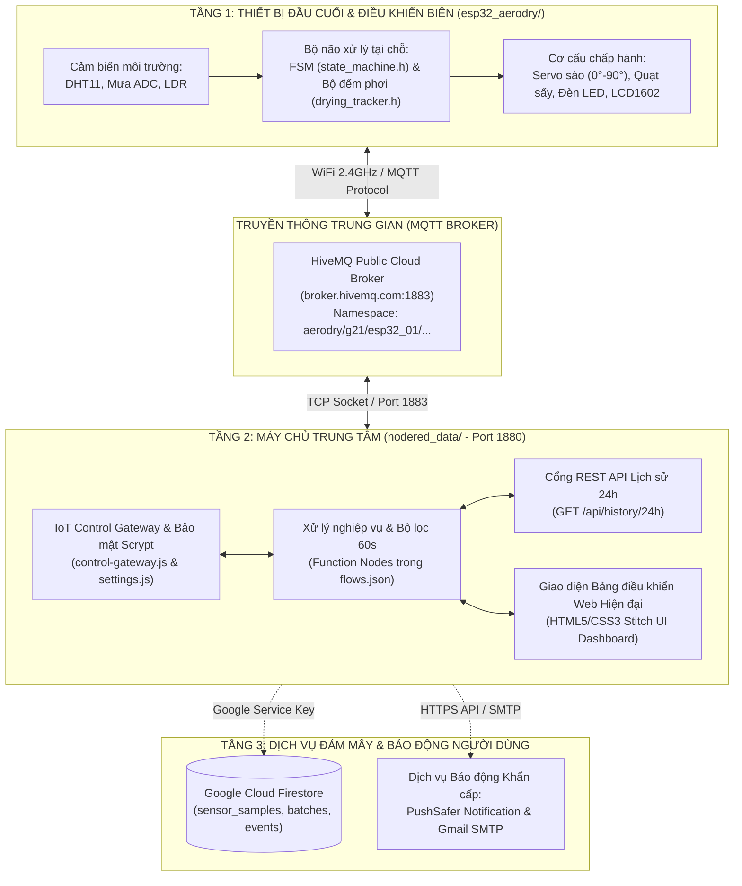
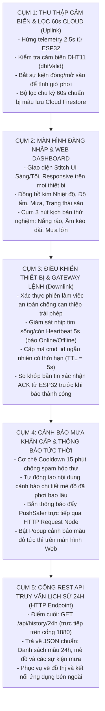

# CẨM NANG BÁO CÁO: ĐẶC TẢ KIẾN TRÚC & CẤU TRÚC HỆ THỐNG AERODRY IoT
## HỆ THỐNG GIÀN PHƠI THÔNG MINH (SMARTBREEZE PRO)
**Môn học:** Vật lý cho Công nghệ Thông tin (PHY00007) – Lớp 24C11 – Nhóm 21  
**Đơn vị:** Trường Đại học Khoa học Tự nhiên – ĐHQG-HCM  
**Phiên bản chuẩn hóa nộp bài:** Tháng 11/2026

---

## 1. CẤU TRÚC MÃ NGUỒN CHUẨN ĐỒ ÁN (SUBMISSION REPOSITORY STRUCTURE)

Dưới đây là cấu trúc thư mục hoàn chỉnh, tinh gọn và chuẩn mực nhất của toàn bộ hệ thống đồ án AeroDry IoT để trình bày và nộp cho Hội đồng / Giảng viên:

```text
D:\III_HK1\VL\Project/
├── esp32_aerodry/                 <--- [TẦNG PHẦN CỨNG] Toàn bộ mã nguồn C++ nhúng nạp vào mạch ESP32
│   ├── esp32_aerodry.ino          <--- Chương trình chính (Vòng lặp setup/loop, điều khiển Servo, Quạt, LED)
│   ├── sensors.h                  <--- Module đọc cảm biến DHT11, cảm biến mưa ADC, quang trở LDR
│   ├── state_machine.h            <--- Bộ máy trạng thái hữu hạn FSM (Auto / Manual / Chờ khô 180s)
│   ├── drying_tracker.h           <--- Bộ đếm thời gian phơi cộng dồn & quản lý mẻ đồ
│   ├── mqtt_contract.h            <--- Khung định dạng bản tin chuẩn MQTT (Telemetry, Ack, Event, Heartbeat)
│   ├── command_protocol.h         <--- Giao thức nhận lệnh điều khiển an toàn từ Web
│   ├── local_io.h                 <--- Xử lý 3 nút nhấn vật lý chống dội (Debounce 50ms)
│   └── config.h                   <--- Cấu hình chân GPIO phần cứng & địa chỉ Broker HiveMQ
│
├── nodered_data/                  <--- [TẦNG TRUNG TÂM] TOÀN BỘ BACKEND, GATEWAY & GIAO DIỆN WEB
│   ├── flows.json                 <--- [TRÁI TIM HỆ THỐNG] Toàn bộ 5 Cụm chức năng Node-RED & Web Dashboard
│   ├── settings.js                <--- Cấu hình khởi động Node-RED, nạp biến môi trường & Module Gateway
│   ├── firebase_key.json          <--- Chìa khóa xác thực bảo mật (Service Account) của Google Cloud Firestore
│   ├── control.local.json         <--- Danh bạ phân quyền tài khoản & mã hóa mật khẩu an toàn (scrypt)
│   └── lib/                       <--- Các module lõi trung tâm của Backend:
│       ├── control-gateway.js     <--- Cổng Gateway điều khiển, cấp mã phiên (Session), so khớp ACK & Timeout 5s
│       └── route-message.js       <--- Bộ định tuyến gói tin giữa Web Dashboard và Broker MQTT
│
├── docs/                          <--- [HỒ SƠ KỸ THUẬT] Toàn bộ tài liệu báo cáo & thiết kế
│   ├── PROJECT_STRUCTURE_GUIDE.md <--- Cẩm nang kiến trúc hệ thống chuẩn nộp bài (Tài liệu này)
│   ├── NODE_RED_FUNCTIONS_EXPLAINED.md <--- Đặc tả chi tiết từng biến và giải thuật trong Function Nodes
│   └── hardware/                  <--- Hồ sơ phần cứng (Bản vẽ mạch layout.svg, linh kiện bom.csv, DESIGN.md)
│
├── package.json                   <--- File quản lý dự án & Lệnh vận hành hệ thống (npm start)
├── .gitignore                     <--- Quy tắc bảo mật (loại bỏ các file tạm, bảo vệ file khóa)
└── README.md                      <--- Hướng dẫn giới thiệu tổng quan đồ án Nhóm 21
```

---

## 2. KIẾN TRÚC HỆ THỐNG 3 TẦNG (THREE-TIER ARCHITECTURE)

Hệ thống được thiết kế theo đúng chuẩn kiến trúc IoT công nghiệp gồm 3 tầng khép kín:



---

## 3. BẢN ĐỒ 5 CỤM CHỨC NĂNG TRÊN GIAO DIỆN NODE-RED (`flows.json`)

Toàn bộ hệ thống Backend và Frontend được tổ chức cực kỳ khoa học thành **5 Cụm chức năng độc lập** trên màn hình Node-RED Editor:



---

## 4. CHI TIẾT CÁC ĐƯỜNG ỐNG TRUYỀN THÔNG (MQTT TOPIC CONTRACT)

Dự án sử dụng cơ chế định danh độc nhất trên máy chủ **HiveMQ Cloud** để đảm bảo không bị xung đột với các hệ thống khác:

| Tên Topic MQTT | Hướng truyền | Chức năng nghiệp vụ | Chu kỳ / Điều kiện kích hoạt |
| :--- | :---: | :--- | :--- |
| **`aerodry/g21/esp32_01/telemetry`** | ESP32 $\rightarrow$ Node-RED | Dữ liệu đo cảm biến (Nhiệt, Ẩm, Mưa, Vị trí sào, Giây phơi) | Định kỳ **2.5 giây/lần** (QoS 0). |
| **`aerodry/g21/esp32_01/heartbeat`** | ESP32 $\rightarrow$ Node-RED | Điểm danh nhịp tim sống còn (Online/Offline) | Định kỳ **5.0 giây/lần** (Quá 25s không có $\rightarrow$ Báo Mất mạng). |
| **`aerodry/g21/esp32_01/cmd`** | Node-RED $\rightarrow$ ESP32 | Gửi lệnh điều khiển (Đẩy sào, Thu sào, Quạt, Đèn, Reset) | Kích hoạt khi người dùng bấm nút trên Web Dashboard. |
| **`aerodry/g21/esp32_01/ack`** | ESP32 $\rightarrow$ Node-RED | Xác nhận phần cứng đã chấp hành xong lệnh điều khiển | Gửi phản hồi ngay sau khi Servo/Relay thực thi xong. |
| **`aerodry/g21/esp32_01/event`** | ESP32 $\rightarrow$ Node-RED | Bắn sự kiện thời tiết bất thường (Mưa lớn, Độ ẩm cao kéo dài) | Kích hoạt tức thì khi cảm biến nước phát hiện mưa. |

---

## 5. HƯỚNG DẪN VẬN HÀNH DỰ ÁN KHI DEMO VÀ NỘP BÀI

Toàn bộ hệ sinh thái đã được tinh gọn và đồng bộ hóa cao độ:

1. **Khởi động duy nhất một lệnh:**
   Mở terminal tại thư mục gốc và chạy:
   ```bash
   npm start
   ```
2. **Truy cập các cổng giao tiếp:**
   * **Bảng điều khiển Web Dashboard:** [http://127.0.0.1:1880/ui](http://127.0.0.1:1880/ui) *(Giao diện người dùng)*
   * **Trình soạn thảo trực quan Node-RED:** [http://127.0.0.1:1880](http://127.0.0.1:1880) *(Sơ đồ 5 cụm flow)*
   * **Cổng REST API Lịch sử 24h:** [http://127.0.0.1:1880/api/history/24h](http://127.0.0.1:1880/api/history/24h) *(Trả về JSON dữ liệu)*
