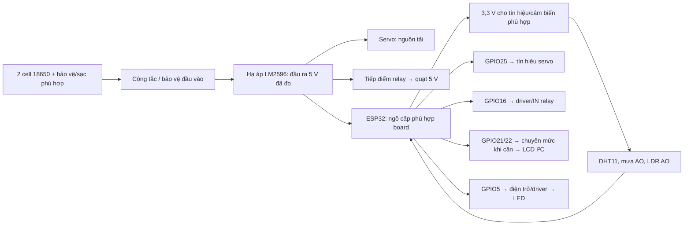

# W08–W11: bố trí, cơ cấu và sơ đồ nối danh định

Chủ trì: Trịnh Khánh Linh. Đây là thiết kế để triển khai mô hình demo, chưa phải bản hoàn công hoặc kết quả đo. Kích thước từ proposal: dài 350 mm, rộng 250 mm, cao 300 mm, Formex 5 mm; servo SG90/MG90S, sào nhẹ và vải nhẹ. Chốt vị trí lỗ, chiều dài tay servo và khoảng hở sau khi có linh kiện thực.

## Bố trí

Xem `layout.svg`: mặt bằng cung xoay 0°–90° và mặt cắt đứng. Đặt sào theo trục xoay ngang (quay trong mặt phẳng ngang); gá giữ thân servo vào khung, không dùng dây điện làm điểm đỡ. Tính cả móc/vải vào vùng quét. Góc 0°/90° là góc yêu cầu danh định, không phải phản hồi đo.

- Khoang đế: ESP32, điểm phân phối nguồn, relay, bộ hạ áp; có nắp kiểm tra.
- Cảm biến mưa: nghiêng ở ngoài mái, có đường thoát nước tránh khoang điện.
- LDR: nhìn ánh sáng môi trường, tránh LED chiếu trực tiếp.
- DHT11: thoáng, tránh giọt nước và luồng quạt thổi sát.
- LCD và ba nút: mặt trước; quạt hướng qua vùng đồ ở dưới mái; LED dưới mái.
- Dây servo có phần chùng phù hợp, không chạy cắt qua cung sào.

## Bảng chân hiện tại trong firmware

| Thành phần | GPIO ESP32 | Quy tắc |
|---|---:|---|
| DHT11 DATA | 4 | Đọc 2,5 giây; mức tín hiệu 3,3 V |
| Mưa AO | 34 | ADC1, 0–3,3 V; hiệu chỉnh ADC thực |
| LDR AO | 35 | ADC1, 0–3,3 V |
| Servo signal | 25 | 50 Hz; pulse 500–2400 µs; hiệu chỉnh góc tránh ép chặn |
| Relay IN quạt | 16 | Mặc định active LOW, inactive HIGH; kiểm tra module thật |
| LED | 5 | HIGH bật; điện trở nối tiếp, bổ sung driver nếu dòng tải yêu cầu |
| Nút Đưa ra | 15 | INPUT_PULLUP, nút nối xuống GND khi nhấn |
| Nút Thu vào | 2 | INPUT_PULLUP, nút nối xuống GND khi nhấn |
| Nút Reset thời gian | 33 | INPUT_PULLUP, nút nối xuống GND khi nhấn |
| LCD SDA / SCL | 21 / 22 | I²C; địa chỉ khởi đầu 0x27 |

GPIO 2/5/15 liên quan cấu hình khởi động của ESP32. Cần kiểm tra boot khi nút được giữ và mức do module ngoài áp lên chân; nếu cấu hình thực không phù hợp, chọn chân khác và cập nhật `config.h` trước đấu nối. Bảng này là mapping phần mềm hiện có, không phải xác nhận đã đo trên board cụ thể.

## Sơ đồ khối điện

Chưa chốt cách ghép hai cell, board bảo vệ/sạc và ngõ cấp ESP32 cụ thể; phải chọn theo module thực và đầu vào yêu cầu của bộ hạ áp. Không suy ra chỉ từ sơ đồ khối rằng mọi tổ hợp hai cell đều phù hợp. Nhánh tải lấy nguồn từ bộ cấp, không qua GPIO; chung GND theo thiết kế. Xác nhận mức logic relay và pull-up I²C LCD, chuyển mức khi module kéo lên 5 V. Kiểm tra cực tính, điện áp và sụt áp theo checklist nghiệm thu trước chạy tải.

## Điều khiển và tình huống khởi động

- Boot: quạt OFF, sào yêu cầu thu, đèn AUTO. Servo không có phản hồi vị trí; cần quan sát cơ cấu khi cấp điện.
- Đưa ra/thu từ nút hoặc web chuyển sào sang MANUAL; không thay chế độ đèn.
- Quạt chỉ bật khi sào thu; relay được cập nhật tắt trước lệnh servo đưa ra.
- Reset chỉ tạo mẻ đồ mới; không xóa Wi-Fi, không xóa lịch sử cloud.
- Trạng thái LCD/web là vị trí yêu cầu; không thông báo “đã đo đến đích”.

## Hồ sơ cần bổ sung sau lắp

Ảnh tổng thể/mặt cắt, sơ đồ dây cuối có đánh số đầu nối, loại module thực, góc servo đã hiệu chỉnh, kết quả đo 5 V/3,3 V lúc tải hoạt động, bảng thử nút/portal/MQTT và log lỗi. Ghi thay đổi chân vào cả tài liệu này và firmware.
